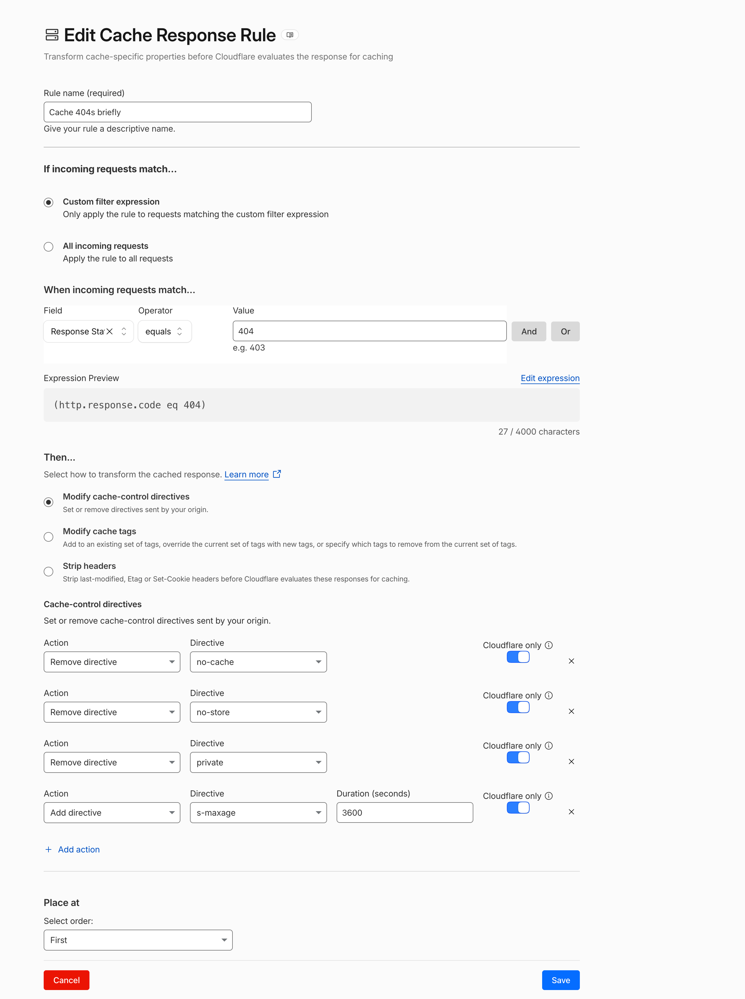

# Cache 404 responses at Cloudflare

Uncached 404 responses are an easy way to overload a WordPress origin server. This page explains why, and how a Cloudflare Cache Response Rule can make Cloudflare serve 404 responses from its edge cache.

## Table of contents

- [The problem: uncached 404 responses](#the-problem-uncached-404-responses)
- [Why WordPress 404 responses are not cached](#why-wordpress-404-responses-are-not-cached)
- [Solution: a Cache Response Rule for 404 responses](#solution-a-cache-response-rule-for-404-responses)
- [Cache invalidation via the `404` cache tag](#cache-invalidation-via-the-404-cache-tag)
- [Verify](#verify)
- [Considerations](#considerations)
- [Limitations and additional measures](#limitations-and-additional-measures)

## The problem: uncached 404 responses

With [Automatic Platform Optimization (APO)](../README.md#automatic-platform-optimization-apo) or Cache Rules, Cloudflare serves most public pages from its edge cache. Requests for URLs that do not exist are different: WordPress responds with `404 Not Found`, and Cloudflare does not cache that response. Every request for a non-existent URL goes to the origin server.

For WordPress, a 404 is not a cheap response. WordPress still loads the full stack (plugins, theme, rewrite rules) and runs database queries before it decides that nothing matches the URL.

Attackers use this. In several recent (D)DoS attacks on sites behind Cloudflare, the attackers requested random, non-existent URLs over and over, for example 273 requests for `/asddsadsa/`, then a few hundred for `/awgasrqwasc/`, and so on. Each of these requests passed Cloudflare and reached the origin, so the attack overloaded the server even though the regular pages were cached.

## Why WordPress 404 responses are not cached

There are two reasons:

1. **APO only caches `200` responses.** APO caches HTML only when the origin responds with status `200` and content type `text/html`. A 404 response is never cached by APO.
2. **WordPress forbids caching of 404 responses.** When WordPress sends a 404, it calls [`nocache_headers()`](https://developer.wordpress.org/reference/functions/nocache_headers/), which sends (since WordPress 6.8):

   ```http
   Expires: Wed, 11 Jan 1984 05:00:00 GMT
   Cache-Control: no-cache, must-revalidate, max-age=0, no-store, private
   ```

   Cloudflare respects these directives and does not store the response, even when a Cache Rule makes the request eligible for cache.

   In the WordPress source code:

   - [`WP::main()`](https://github.com/WordPress/WordPress/blob/7.1/wp-includes/class-wp.php#L818-L825) calls `WP::handle_404()` on every front-end request.
   - [`WP::handle_404()`](https://github.com/WordPress/WordPress/blob/7.1/wp-includes/class-wp.php#L797-L801) sets the 404 status and calls `nocache_headers()` when no content matches the request.
   - [`nocache_headers()`](https://github.com/WordPress/WordPress/blob/7.1/wp-includes/functions.php#L1543-L1557) sends the headers from `wp_get_nocache_headers()`.
   - [`wp_get_nocache_headers()`](https://github.com/WordPress/WordPress/blob/7.1/wp-includes/functions.php#L1508-L1509) defines the `Cache-Control` directives.

The Pronamic Cloudflare cache headers leave existing cache policy headers unchanged, so they do not override the WordPress `nocache_headers()` on 404 responses.

## Solution: a Cache Response Rule for 404 responses

Cloudflare [Cache Response Rules](https://developers.cloudflare.com/cache/how-to/cache-response-rules/) change cache-related properties of the origin response *before* Cloudflare decides whether to cache it. Unlike Cache Rules, they can match on the response status code, so they can target 404 responses only.



In the Cloudflare dashboard, go to **Caching > Cache Rules** and create a Cache Response Rule:

| Setting | Value |
| --- | --- |
| Rule name | `Cache 404s briefly` |
| If incoming requests match… | Custom filter expression |
| Expression | `(http.response.code eq 404)` |
| Then… | Modify cache-control directives |
| Place at | First |

With the following cache-control directives, each with **Cloudflare only** enabled:

| Action | Directive | Duration |
| --- | --- | ---: |
| Remove directive | `no-cache` | |
| Remove directive | `no-store` | |
| Remove directive | `private` | |
| Add directive | `s-maxage` | `3600` |

The `s-maxage` directive tells shared caches such as Cloudflare how long they may keep the response and takes precedence over `max-age=0` and `Expires`.

**Cloudflare only** is important: the rule then only changes how Cloudflare treats the response. Browsers still receive the original `Cache-Control` header from WordPress and do not cache the 404 page.

### Cache eligibility

A Cache Response Rule only changes the cache-control directives. The request itself must still be [eligible for cache](https://developers.cloudflare.com/cache/concepts/default-cache-behavior/). Cloudflare does not cache HTML by default, so the 404 responses are only stored if a Cache Rule makes these requests eligible for cache. If you already use such a Cache Rule for the [cache headers](../README.md#cache-headers) of this plugin, nothing else is needed. If you only use APO, check with the steps under [Verify](#verify) whether the 404 responses are actually cached.

## Cache invalidation via the `404` cache tag

A cached 404 can become wrong: if you later publish a page on that URL, visitors should not get a cached "not found" page.

The Pronamic Cloudflare plugin handles this. Every 404 response carries the `Cache-Tag: 404` header, and the plugin invalidates the `404` cache tag whenever posts or terms are created, changed or deleted. A new page therefore replaces a cached 404 immediately, and a TTL of an hour (or longer) is safe.

Without this plugin, keep the TTL short (for example 60 seconds). Even a short TTL is enough to absorb hundreds of requests for the same URL.

## Verify

Request a random URL twice and inspect the response headers:

```bash
curl -sI https://example.com/random-url-123/ | grep -i -E "^(HTTP|cache-control|cache-tag|cf-cache-status|set-cookie)"
```

- First request: `cf-cache-status: MISS`.
- Second request: `cf-cache-status: HIT`.

If you see `cf-cache-status: DYNAMIC`, the request is not eligible for cache (see [Cache eligibility](#cache-eligibility)). If you still see `MISS` on repeated requests, check whether the origin sends other directives that prevent caching, or a `Set-Cookie` header.

### Tip: request the origin directly

To see what the origin server itself sends, bypass Cloudflare with the `curl` option [`--resolve`](https://curl.se/docs/manpage.html#--resolve). It connects to the IP address of the origin server, while the host name, TLS (SNI) and `Host` header stay the same:

```bash
curl -I --resolve www.example.com:443:192.0.2.10 https://www.example.com/random-url-123/
```

Replace `192.0.2.10` with the IP address of your origin server. The response should not contain any `cf-*` headers. This shows which `Cache-Control` directives, `Cache-Tag` and `Set-Cookie` headers the origin sends, so you know which directives the Cache Response Rule must remove.

If the origin only allows Cloudflare traffic, for example with Authenticated Origin Pulls or an IP allowlist, this request fails. That is expected.

## Considerations

- **Logged-in users.** A 404 page for a logged-in user can contain user-specific content such as the admin bar or nonces. Make sure the Cache Rule that makes requests eligible for cache excludes logged-in users, for example on the `wordpress_logged_in_` cookie.
- **`Set-Cookie` headers.** Cloudflare does not cache responses with a `Set-Cookie` header. If a plugin or theme sets a cookie on 404 pages, the response is not cached. Avoid this on public pages, or use the **Strip headers** option of a Cache Response Rule if the cookie is not needed.
- **Only remove the directives that are actually sent.** Check the origin response with `curl` (see [Verify](#verify)). Other plugins or the web server can send different directives than WordPress.

## Limitations and additional measures

Caching 404 responses absorbs repeated requests for the same non-existent URL, the pattern seen in recent attacks. It does not stop an attack in which every request uses a unique URL: the first request for each URL still reaches the origin. Consider these additional measures:

- **WAF custom rules / Managed Challenge** on suspicious patterns such as countries, ASNs, user agents or missing headers, and [Under Attack Mode](https://developers.cloudflare.com/fundamentals/reference/under-attack-mode/) during an attack.
- **Rate limiting.** Counting 404 responses per IP requires Cloudflare [Advanced Rate Limiting](https://developers.cloudflare.com/waf/rate-limiting-rules/) (Enterprise). On other plans, rate limiting rules can only count requests.
- **Make 404 responses cheap at the origin**, for example with a persistent object cache and a lightweight 404 template.
- **Only allow Cloudflare traffic at the origin** ([Authenticated Origin Pulls](https://developers.cloudflare.com/ssl/origin-configuration/authenticated-origin-pull/) or an IP allowlist), so attackers cannot bypass Cloudflare.
